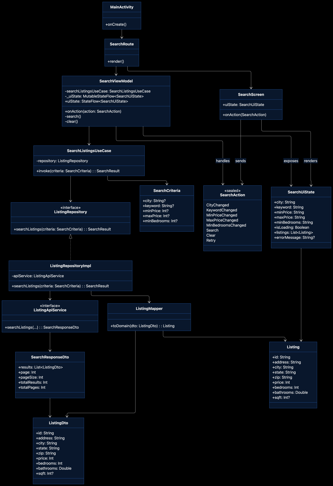
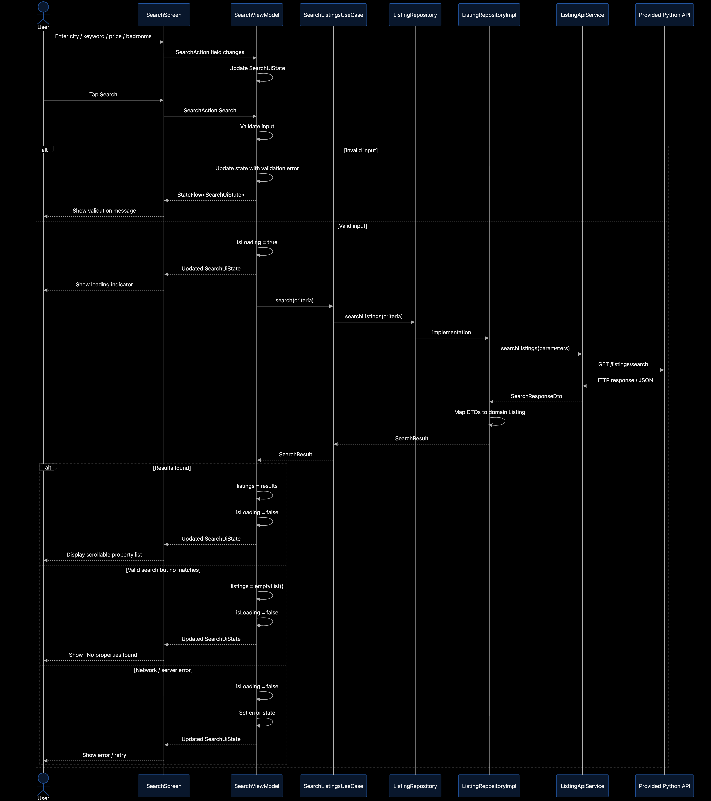

# Listing Search — Android Coding Assessment

A native Kotlin/Jetpack Compose property search app built against the provided Python Listing Search Service.

## Architecture
This project is intentionally inspired by the modular, unidirectional-data-flow ideas in Google's **Now in Android** sample, scaled down for a take-home assessment.

### Class Diagram



### Search Sequence Diagram



### Module Dependency Diagram

See [docs/module-diagram.md](docs/module-diagram.md) for the full diagram. In short:

```text
:app             → :feature:search, :common:data, :common:network
:feature:search  → :common:data, :common:model
:common:data     → :common:model, :common:network
:common:network  → (none)
:common:model    → (none)
```

`:app` depends on `:common:data` and `:common:network` only so Hilt can build the dependency graph.

- **app** — application/composition root only.
- **feature:search** — Compose UI + `SearchViewModel` + immutable `SearchUiState` + `SearchAction` (MVI-style UDF implemented with MVVM).
- **common:model** — UI/framework-independent domain models and search criteria.
- **common:network** — Retrofit service and API DTOs.
- **common:data** — repository contract/implementation, DTO→domain mapping, use case.

The dependency graph is one-directional. UI does not depend directly on Retrofit or API DTOs.

## Why MVI-style UDF + MVVM?
The ViewModel owns one immutable `SearchUiState`. UI sends `SearchAction`s and renders state. This keeps state transitions predictable while retaining standard Android ViewModel/lifecycle integration. It also makes new filters straightforward to add during a live requirement change.

## Run the API
Copy/use the provided `server.py` and `data.json` in the same directory:

```bash
python3 server.py
```

The Android emulator reaches the host machine at `http://10.0.2.2:8000/`. The app is configured for that address and enables cleartext HTTP only because the provided local assessment API uses HTTP.

Verify the API first:

```bash
curl http://localhost:8000/health
```

## Run the Android app
1. Open this folder in Android Studio.
2. Allow Gradle sync to complete.
3. Start an Android emulator.
4. Make sure `server.py` is running.
5. Run the `app` configuration.

## Implemented requirements
- Native Kotlin + Jetpack Compose.
- Search by city or keyword.
- Minimum and maximum price.
- Minimum bedrooms (supported by the provided endpoint).
- Scrollable listing results.
- Address, price, bedrooms, bathrooms, square footage, description, status/date.
- Loading, empty and error states.
- Local validation for `minPrice <= maxPrice` while still handling HTTP errors.
- Hilt dependency injection.
- Unit tests for ViewModel validation and state behavior.

## Deliberate tradeoffs
- **No Room/offline cache:** not required by the take-home. A local source can be added behind `ListingRepository` without changing the feature UI contract.
- **No deduplication:** the provided data contains duplicate/near-duplicate metadata, but product behavior for merging records is not specified. I preserve the network boundary rather than inventing a business rule.
- **No rental/amenities UI:** the server supports additional capabilities, but they are not necessary for the required MVP. Existing boundaries make them straightforward extensions.
- **No pagination UI yet:** API pagination metadata is modeled, but the first version intentionally prioritizes required behavior and clarity.

## How I would extend it
- Add pagination/load-more by adding page actions/state without exposing Retrofit to UI.
- Add Room as local source of truth for offline-first browsing.
- Add rental search as a separate feature/use case while sharing design/network infrastructure.
- Add amenity filters to `SearchCriteria` and network mapping.
- Add domain-level deduplication only after product rules define source precedence/confidence thresholds.

## Interview talking point
The architecture is not modularized simply because “Clean Architecture says so.” The boundaries isolate reasons to change: API serialization can change without rewriting Compose, search presentation can evolve without knowing transport details, and new data sources can be added behind the repository contract.
